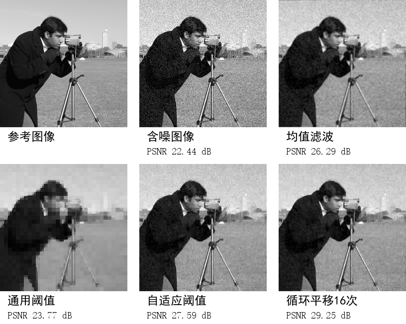

# Haar 小波阈值与循环平移图像去噪

本项目为《图像处理与分析》课程大作业的可复现代码。复现通用软阈值与子带自适应阈值，在自适应阈值基线上加入循环平移平均，比较去噪质量和计算成本。BayesShrink 与 cycle spinning 均来自已有文献，本项目的工作是独立实现、组合和受控实验，不声称提出新算法。

作者：王智，学号20245629。

## 实测结果

在标准差20的高斯噪声下，四张图片、每张五次重复的均值如下。

| 方法 | PSNR dB | SSIM |
| --- | ---: | ---: |
| 含噪图像 | 22.41 | 0.4323 |
| 3×3均值滤波 | 26.80 | 0.7229 |
| VisuShrink | 23.29 | 0.6014 |
| BayesShrink | 27.35 | 0.7021 |
| BayesShrink加16次循环平移 | 29.08 | 0.7730 |

下图展示camera、标准差20、重复序号0的一次结果；图中数值与上表的跨图像均值不同。



## 环境与运行

建议 Python 3.11 或以上。本次实测环境写在 `results/environment.json`。

```bash
python -m pip install -r requirements.txt
python check_correctness.py
python run_experiment.py
```

在当前 code 目录执行；脚本也支持从其他工作目录运行。全部图片已附带，复现实验无需再次下载。普通 CPU 即可运行，耗时依硬件而异。重新运行会覆盖 `results/` 中同名实验结果。

处理自己的图片：

```bash
python denoise.py --input my_image.png --output my_denoised.png --grid 4
```

输入彩色图片时转换成灰度；任意尺寸会先对称填充到8的倍数，输出再裁回原尺寸。真实噪声未必符合高斯模型，效果应结合图像内容检查。

## 文件说明

- `denoise.py`：正交 Haar 分解重构、噪声估计、VisuShrink、BayesShrink、循环平移、PSNR、SSIM。
- `run_experiment.py`：60组配对实验，每组7个方法，包含1、4、16、64次平移消融。
- `check_correctness.py`：可逆性、能量守恒、软阈值、SSIM和完整相位平均的平移一致性检查。
- `data/`：四张原始图片及下载URL、SHA256清单。
- `results/metrics.csv`：420行原始评价，每行包含图片、噪声强度、随机种子、方法、PSNR、SSIM、MSE、算法耗时。
- `results/summary.json`：每档噪声下跨图片与种子的均值、标准差、耗时中位数。
- `results/examples/`：报告可视化使用的浮点输出，避免8位量化影响评价。

## 实验约定

短边缩放到256、中心裁剪256×256；Pillow灰度变换；三层正交 Haar。加性白高斯噪声标准差为10/255、20/255、30/255；加噪输入不截断，所有方法输出统一截断至[0,1]后评价。随机种子为 `20261101 + image_index*10000 + sigma*100 + seed`，其中seed为0到4，图片顺序为camera、chelsea、coffee、astronaut。同一组实验的所有方法使用同一噪声输入。

算法仅接收含噪图像，通过最细对角子带的绝对值中位数估计噪声；干净图像仅用于加噪和评价。循环平移中的每次去噪重新估计噪声。基线与改进均保留最粗低频子带。PSNR的data_range=1；SSIM采用11×11、sigma=1.5的高斯窗口、K1=0.01、K2=0.03、总体加权矩，只平均有效区域。结果先计算各试验的指标，再等权平均。

计时使用 `time.perf_counter`，预热一次，仅统计算法本身；不包含读写文件、截断、评价、绘图。计时不是严格微基准，会受CPU频率、后台负载影响。标准差混合了图像内容差异和随机噪声差异，不能解释为独立样本的置信区间。四张图只适合课程演示，不能代表大规模泛化能力。16次平移是结合本实验消融选取的质量与速度折中，未另设独立验证集。

## 数据来源与许可

原始文件来自 scikit-image v0.19.3，详细链接和文件哈希见 `data/manifest.json`。数据许可说明见官方文档：
https://scikit-image.org/docs/stable/api/skimage.data.html

- camera：Lav Varshney，CC0。
- chelsea：Stefan van der Walt，CC0。
- coffee：Rachel Michetti，CC0。
- astronaut：NASA Eileen Collins图片，公有领域，使用说明见官方数据文档。

项目实现未复制 scikit-image 的去噪源代码，独立以 NumPy 实现。数据许可保持原样。

## 算法参考

1. Chang S G, Yu B, Vetterli M. Adaptive Wavelet Thresholding for Image Denoising and Compression. IEEE TIP, 9(9):1532–1546, 2000. DOI:10.1109/83.862633.
2. Coifman R R, Donoho D L. Translation-Invariant De-Noising. Wavelets and Statistics, 125–150, 1995. https://web.stanford.edu/dept/statistics/cgi-bin/donoho/wp-content/uploads/2018/08/TIDeNoise.pdf
3. Wang Z, Bovik A C, Sheikh H R, Simoncelli E P. Image Quality Assessment: From Error Visibility to Structural Similarity. IEEE TIP, 13(4):600–612, 2004. https://ece.uwaterloo.ca/~z70wang/publications/ssim.pdf
4. scikit-image循环平移示例：https://scikit-image.org/docs/stable/auto_examples/filters/plot_cycle_spinning.html
5. 公开参考项目：https://github.com/scikit-image/scikit-image

## 上传 GitHub

创建自己的仓库，把本目录内容放在仓库根目录即可；再把最终仓库链接补入报告。可以一并上传报告PDF。上述公开参考项目并非本项目的个人仓库。
